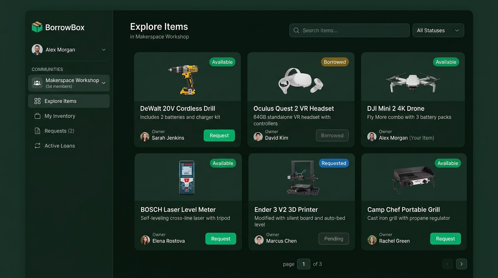

# BorrowBox

> A full-stack community-based platform for sharing and tracking physical assets across bounded communities.

[](https://github.com/Furquanis1/BorrowBox/actions/workflows/build.yml)


---

## 📸 Preview



---

## 🌐 Live Demo & Deployment Status

BorrowBox is fully containerized and ready for local or cloud deployment.
- **Local Demonstration:** Ready out-of-the-box using one-click launch scripts (`run_demo.bat` / `run_demo.sh`), which manage the required demo credentials, or directly with Docker Compose when the required environment variables are supplied.
- **Cloud Deployment:** GitHub Actions CI/CD pipeline ([deploy.yml](.github/workflows/deploy.yml)) is configured for Railway and Render deployment hooks when repository secrets are provided.

---

## What is BorrowBox?

BorrowBox is a community-based asset-sharing platform. Users own physical assets independently of communities, then selectively expose them to specific communities via CommunityListings. Community members discover available assets through community-scoped Explore. A single owned asset pool shared across multiple communities always shows one consistent shared physical inventory state.

V2.1 (Community + Ownership Foundation) delivers:

- Community creation with MANAGER_APPROVAL and LOCATION_VERIFIED admission
- Membership with community-specific roles and context metadata (JSON)
- Global asset ownership with immediate AssetUnit materialization
- CommunityListing: selective visibility of owned assets to communities
- Community-scoped Explore with aggregate availability (shared across listings)
- Deterministic seed data and idempotent development reset
- Docker health-gated startup with backend healthcheck

V2.1 does not include transactions, borrowing workflows, messaging, notifications, reputation, or AI. See `docs/BORROWBOX_ROADMAP.ipynb` for the full roadmap.

V2.2.1 (Transaction Negotiation) delivers the first slice of the transaction engine:

- Structured borrow requests: borrower states purpose + duration (1–30 days)
- Lender approve / reject / counter-offer; borrower accept-counter / cancel
- Race-safe basis reservation: pessimistic DB lock + `UNIQUE(reserved_unit_id)` backstop, exactly-one-wins
- Explore "Request" drawer and a Requests inbox (`/me/requests`, `/me/lend-requests`)
- Backend/database is authoritative for reservation ordering; AssetUnit IDs are never exposed

📄 **Project Pitch & Overview:** See the one-page project pitch in [Markdown](docs/PITCH.md) or download the [Pitch PDF](docs/assets/borrowbox-project-pitch.pdf).

---

## Core Features (V2.1 → V2.2.2)

| Module | Implemented Capabilities |
|---|---|
| **Authentication & Security** | BCrypt password hashing, stateless HttpOnly JWT cookies, global exception handling, protected React route guards. |
| **Community + Membership** | Community creation with type/location/admission mode, MANAGER_APPROVAL and LOCATION_VERIFIED join flows, community-specific roles and context metadata (JSON), manager controls. |
| **Asset Ownership** | Global asset ownership independent of communities, atomic Asset + N AssetUnit creation, owner inventory at `/me/inventory`. |
| **CommunityListing** | Selective visibility: one Asset listed in multiple communities, shared physical inventory pool, authorization enforced server-side (owner must have ACTIVE membership). |
| **Community Explore** | Community-scoped listing discovery with aggregate availability (totalUnits, availableUnits, borrowedUnits), AssetUnit IDs hidden from public API. |
| **Shared Availability** | Changing one AssetUnit status affects availability across all communities where the Asset is listed. Backend/database is authoritative. |
| **Transaction Negotiation (V2.2.1)** | Lifecycle: PENDING → APPROVED/REJECTED/COUNTER_OFFERED/CANCELLED. Borrower reservation holds unit; lender accepts or counters. Approval is forward-only. |
| **Loan Lifecycle (V2.2.2)** | Borrower completes handover (APPROVED → AWAITING_HANDOVER → ACTIVE). Borrower initiates return → lender confirms receipt → COMPLETED. Authoritative startedAt/completedAt timestamps. Dedicated `/me/loans` view. |

---

## Future Roadmap (BorrowBox V2.2+)

*Planned features beyond the V2.2.2 loan lifecycle slice:*
- **Transaction Engine:** Extensions, overdue/expiry handling, messaging, representative handovers, disputes, evidence photos, flagging.
- **Trust + Ledger:** Borrow/lending history, reputation events, reliability metrics, badges.
- **Community Health:** Manager dashboard, membership review, flags, moderation.
- **Condition + Evidence Intelligence:** Evidence timeline, condition metadata, before/after comparison.
- **Notifications + Automation:** In-app, email, push notifications.
- **AI + Tribunal:** AI-assisted condition comparison, blind tribunal, anonymous peer review.

---

## 🛠️ Tech Stack

| Layer | Technology |
|---|---|
| **Backend API** | Java 21, Spring Boot 3.5, Spring Security, Spring Data JPA, Hibernate ORM, Maven |
| **Database** | MySQL 8.0 (InnoDB), HikariCP connection pooling, dynamic JPA Specifications |
| **Authentication** | Stateless JWT stored in HttpOnly cookies, BCrypt password encoder |
| **Frontend SPA** | React 18.2, Vite 5, React Router 7, Custom CSS Design System |
| **API Docs** | Springdoc OpenAPI 3.0 / Swagger UI |
| **DevOps & Containerization** | Multi-stage Docker builds, Docker Compose, Nginx reverse proxy, launch scripts (`run_demo.bat` / `run_demo.sh`) |
| **Testing** | JUnit 5, Mockito, MockMvc, Cypress 15 E2E testing (57 automated tests) |
| **CI/CD** | GitHub Actions ([build.yml](.github/workflows/build.yml), [e2e.yml](.github/workflows/e2e.yml), [deploy.yml](.github/workflows/deploy.yml)) |

---

## 🚀 Quick Start (Docker — Recommended)

### Prerequisites
- [Docker Desktop](https://www.docker.com/products/docker-desktop/) installed and running.
- [Git](https://git-scm.com/) installed.

### 1. Clone the repository
```bash
git clone https://github.com/Furquanis1/BorrowBox.git
cd BorrowBox
```

### 2. One-Click Launch

**Windows:**
```cmd
run_demo.bat
```

**Linux / macOS:**
```bash
chmod +x run_demo.sh
./run_demo.sh
```

**Or using Docker Compose directly:**
```bash
# Read the required database passwords from the protected launcher credentials file.
export MYSQL_ROOT_PASSWORD="$(sed -n 's/^MYSQL_ROOT_PASSWORD=//p' .borrowbox-demo-credentials)"
export BORROWBOX_APP_DB_PASSWORD="$(sed -n 's/^BORROWBOX_APP_DB_PASSWORD=//p' .borrowbox-demo-credentials)"
export BORROWBOX_E2E_DB_PASSWORD="$(sed -n 's/^BORROWBOX_E2E_DB_PASSWORD=//p' .borrowbox-demo-credentials)"
export APP_JWT_SECRET='<your-secret>'
docker compose up -d --build
```
Compose has no default database credentials and fails safely if they are missing.
Windows PowerShell must set the equivalent process environment variables from the
same protected file.

This starts the orchestrated stack:
- `borrowbox-mysql` — MySQL 8.0 database (mapped to host port `3307` to avoid local MySQL conflicts)
- `borrowbox-mysql-bootstrap` — one-shot service that creates the app and E2E accounts
- `borrowbox-backend` — Spring Boot REST API on port `8080`, connected as `borrowbox_app`
- `borrowbox-frontend` — React application served by Nginx on port `3000`

The one-click launchers explicitly opt in to demo seeding and store the generated
demo-user, MySQL root, app, and E2E passwords in `.borrowbox-demo-credentials` at
the repository root. That file is ignored by Git, is restricted to the current
user, and is reused across ordinary restarts. The launchers export the root value
only to MySQL/bootstrap, the app value to the backend, and the E2E value to Cypress;
the backend never receives root. Use `--clean` to remove both the demo database and
the credentials file. If the credentials file is missing while a demo database
still exists, or if it lacks `MYSQL_ROOT_PASSWORD`, the launcher refuses to start
rather than silently replacing the existing database password.

Launching with plain `docker compose up` does **not** enable demo seeding and still
requires the three database passwords from the environment. To opt in to seeding
there, also set `BORROWBOX_SEED_ENABLED=true` and a non-blank
`BORROWBOX_SEED_PASSWORD` before starting Compose.

### 3. Service URLs

| Service | URL | Notes |
|---|---|---|
| **Frontend (React UI)** | [http://localhost:3000](http://localhost:3000) | Main web interface |
| **Backend Health Check** | [http://localhost:8080/api/health](http://localhost:8080/api/health) | Verifies database connectivity |
| **Swagger API Docs** | [http://localhost:8080/swagger-ui.html](http://localhost:8080/swagger-ui.html) | Interactive OpenAPI documentation |

### 4. Stop Services & Cleanup

- **Stop containers:**
  ```bash
  # Windows
  run_demo.bat --stop

  # Linux / macOS
  ./run_demo.sh --stop

  # Or Compose (MYSQL_ROOT_PASSWORD, BORROWBOX_APP_DB_PASSWORD,
  # BORROWBOX_E2E_DB_PASSWORD, and APP_JWT_SECRET must be in the environment)
  docker compose down
  ```

- **Full reset (stop containers, wipe database volumes, and clear local demo credentials):**
  ```bash
  # Windows
  run_demo.bat --clean

  # Linux / macOS
  ./run_demo.sh --clean

  # Or Compose (requires the same environment values; removes the volume, but not
  # .borrowbox-demo-credentials)
  docker compose down -v
  ```
  Only this explicit reset removes the database volume. Changing credentials does
  not rotate an existing database password.

---

## Local Development

To run the application locally outside of Docker:

### 1. Database
Ensure MySQL 8.0 is running with database `borrowbox_v2`:
```bash
# Or start just the MySQL container
# MYSQL_ROOT_PASSWORD, BORROWBOX_APP_DB_PASSWORD, BORROWBOX_E2E_DB_PASSWORD,
# and APP_JWT_SECRET must already be in the environment; see the direct Compose
# instructions above.
docker compose up -d mysql
```

To reset the local database and provision the app/E2E accounts:
```powershell
$env:BORROWBOX_APP_DB_PASSWORD = '<app-password>'
$env:BORROWBOX_E2E_DB_PASSWORD = '<e2e-password>'
.\scripts\reset-v2-db.ps1
```
The reset script requires the two account passwords in the environment, sets
those passwords on the `borrowbox_app` and `borrowbox_e2e` accounts, and prompts
for the local MySQL administrator credentials (or reads
`BORROWBOX_RESET_DB_USER` / `BORROWBOX_RESET_DB_PASSWORD`). It never prints or
stores them.

### 2. Backend (Spring Boot)
```powershell
cd backend
$env:SPRING_DATASOURCE_URL = 'jdbc:mysql://127.0.0.1:3306/borrowbox_v2'
$env:SPRING_DATASOURCE_USERNAME = 'borrowbox_app'
$env:SPRING_DATASOURCE_PASSWORD = '<app-password>'
mvn clean spring-boot:run
```
The backend starts on `http://localhost:8080` as `borrowbox_app`. Schema
initialization runs by default for local development, but demo seeding is
**disabled by default**. To opt in explicitly, set both
`BORROWBOX_SEED_ENABLED=true` and a non-blank `BORROWBOX_SEED_PASSWORD` in the
backend's environment. Starting without a password while seeding is enabled fails
clearly instead of falling back to a committed default.

### 3. Frontend (Vite Dev Server)
```bash
cd frontend
npm install
npm run dev
```
Open `http://localhost:5173` for hot-reloading development (requests to `/api` are automatically proxied to `http://localhost:8080`).

---

## Testing & Verification

BorrowBox maintains a comprehensive test suite across unit, integration, and end-to-end layers:

### Run Backend Tests
```bash
cd backend
mvn test
```
*Requires local MySQL running on port 3306 with database `borrowbox_v2` and a
`borrowbox_app` account. Set `SPRING_DATASOURCE_USERNAME=borrowbox_app` and
`SPRING_DATASOURCE_PASSWORD` from `BORROWBOX_APP_DB_PASSWORD`.*

### Build Frontend
```bash
cd frontend
npm run build
```
*Validates modules, compiles JSX, bundles CSS, and confirms production asset generation with zero errors.*

### Run Cypress End-to-End Tests (57 Tests)
With the application running on `http://localhost:3000`, and a seeded backend:
```bash
cd frontend
export CYPRESS_SEED_PASSWORD='<same value as the seeded backend>'
export CYPRESS_DB_USER='borrowbox_e2e'
export CYPRESS_DB_PASSWORD='<E2E database password>'
export CYPRESS_TEST_USER_PASSWORD='<per-run test account password>'
npx cypress run --headless
```
On Windows PowerShell, set `$env:CYPRESS_SEED_PASSWORD`, `$env:CYPRESS_DB_USER`,
`$env:CYPRESS_DB_PASSWORD`, and `$env:CYPRESS_TEST_USER_PASSWORD` instead. When
using the local launcher, read the database values from
`.borrowbox-demo-credentials`. The CI E2E workflow generates ephemeral test-only
passwords and supplies the same values to the backend and Cypress. No shared demo
password is committed to the specs or used for the test account. CI workflows
require the `CI_MYSQL_ROOT_PASSWORD` repository secret; see
[GITHUB_SECRETS.md](GITHUB_SECRETS.md).

*Covers Landing Page, Authentication, Dashboard Routing, Community Listings, Shared Inventory Availability, V2.1 Completion Flow, and the V2.2.2 end-to-end loan lifecycle.*

---

## 🔧 Practical Troubleshooting Guide

Here are practical solutions for common local development and runtime issues:

### 1. Docker Desktop Not Running
- **Symptom:** `error during connect: This error may indicate that the docker daemon is not running.`
- **Fix:** Launch Docker Desktop from the Start Menu / Applications and wait for the status indicator to turn green before running `run_demo.bat` or `docker compose up`.

### 2. Port 8080 Already in Use
- **Symptom:** Backend container fails to bind to port 8080 or throws `Address already in use`.
- **Fix:** Identify and terminate the process occupying port 8080:
  - *Windows (PowerShell):* `Get-Process -Id (Get-NetTCPConnection -LocalPort 8080).OwningProcess | Stop-Process -Force`
  - *Linux/macOS:* `lsof -ti:8080 | xargs kill -9`

### 3. Port 3000 Already in Use
- **Symptom:** Frontend container fails to start because port 3000 is occupied.
- **Fix:** Stop existing web applications running on port 3000:
  - *Windows (PowerShell):* `Get-Process -Id (Get-NetTCPConnection -LocalPort 3000).OwningProcess | Stop-Process -Force`
  - *Linux/macOS:* `lsof -ti:3000 | xargs kill -9`

### 4. MySQL Port Conflict (Port 3306)
- **Note:** BorrowBox maps the MySQL container to host port **3307** (`3307:3306`) in `docker-compose.yml` to prevent conflicts with any local MySQL instances running on port 3306. Local development uses port 3306 directly.

### 5. Backend Startup Timing / Database Waiting
- **Symptom:** Backend container restarts or logs HikariCP connection retry warnings.
- **Fix:** The MySQL container takes a few seconds to complete internal initialization on first start. Docker Compose waits for MySQL healthcheck before starting the backend. The backend healthcheck (`/api/health`) ensures the frontend does not start until the API is ready.

### 6. Resetting Corrupted or Stale State
- **Symptom:** Database schema inconsistencies or stale session cookies.
- **Fix:** Execute a clean reset:
  ```bash
  # Docker reset (all three database passwords and APP_JWT_SECRET must be in the environment)
  docker compose down -v
  docker compose up -d --build
  ```
  Prefer `run_demo.bat --clean` / `./run_demo.sh --clean`, which also clears the
  local demo credentials file.
  For local development:
  ```powershell
  $env:BORROWBOX_APP_DB_PASSWORD = '<app-password>'
  $env:BORROWBOX_E2E_DB_PASSWORD = '<e2e-password>'
  .\scripts\reset-v2-db.ps1
  cd backend
  $env:SPRING_DATASOURCE_URL = 'jdbc:mysql://127.0.0.1:3306/borrowbox_v2'
  $env:SPRING_DATASOURCE_USERNAME = 'borrowbox_app'
  $env:SPRING_DATASOURCE_PASSWORD = $env:BORROWBOX_APP_DB_PASSWORD
  mvn spring-boot:run
  ```
  Then clear cookies/localStorage in your browser or use an incognito window.

### 7. MySQL Credential Mismatch on an Existing Volume
- **Symptom:** MySQL healthcheck stays unhealthy, MySQL logs `Access denied`, or the backend cannot connect after credentials changed.
- **Cause:** MySQL uses `MYSQL_ROOT_PASSWORD` only when initializing an empty data directory. The existing `mysql_data` volume keeps the password stored in that database.
- **Fix:** Set `MYSQL_ROOT_PASSWORD` in `.borrowbox-demo-credentials` to the password the existing database already uses. Do not generate a replacement for an existing database. If the password is unknown, recover it from a backup or, only if the demo data is disposable, run `--clean` (destructive). Changing the credential file alone does not rotate the stored MySQL password.

### 8. Application Account Authentication Fails
- **Symptom:** The backend reports `Access denied for user 'borrowbox_app'`.
- **Cause:** The `mysql_data` volume contains an app account with a password that does not match `BORROWBOX_APP_DB_PASSWORD`; bootstrap uses `CREATE USER IF NOT EXISTS` and deliberately does not alter existing users.
- **Fix:** Use the credential the existing account already has, or perform an explicit coordinated `ALTER USER` and update `.borrowbox-demo-credentials`. Do not switch the backend to root.

### 9. Inspecting Container Logs
- **Backend logs:** `docker compose logs -f backend`
- **Frontend logs:** `docker compose logs -f frontend`
- **MySQL logs:** `docker compose logs -f mysql`

---

## Project Structure

```
BorrowBox/
├── .github/
│   └── workflows/
│       ├── build.yml         # CI build, Maven tests, Docker Buildx verification
│       ├── e2e.yml           # Headless Cypress E2E pipeline with live MySQL
│       └── deploy.yml        # Deployment automation (Railway & Render hooks)
├── backend/                  # Spring Boot REST API (Java 21)
│   ├── src/main/java/com/borrowbox/
│   │   ├── config/           # Security, CORS, OpenAPI, SeedDataInitializer
│   │   ├── controller/       # REST endpoints (Auth, Community, Asset, Listing, Health)
│   │   ├── dto/              # Request & Response DTOs
│   │   ├── entity/           # JPA Entities (User, Community, Membership, Asset, AssetUnit, CommunityListing, etc.)
│   │   ├── exception/        # Global exception handler
│   │   ├── repository/       # Spring Data JPA repositories
│   │   ├── security/         # JWT filter & authentication logic
│   │   ├── service/          # Business logic services
│   │   └── spec/             # Dynamic JPA Specifications
│   ├── src/test/java/        # Unit, service, controller, and integration tests
│   └── Dockerfile
├── frontend/                 # React 18 + Vite SPA
│   ├── cypress/              # Cypress E2E tests (6 spec files, 57 tests)
│   │   └── e2e/              # auth, landing, dashboard, listings, completion, loan-lifecycle
│   ├── src/
│   │   ├── components/       # UI components
│   │   ├── contexts/         # React Contexts (AuthContext)
│   │   ├── pages/            # Page components & DashboardLayout
│   │   └── utils/            # API client and helper utilities
│   ├── nginx.conf            # Production Nginx reverse proxy configuration
│   └── Dockerfile
├── scripts/
│   ├── bootstrap-mysql.sh    # Creates the local/CI app and E2E accounts
│   ├── apply-schema.sh       # Applies schema SQL with the production migrator account
│   └── reset-v2-db.ps1       # Local V2.1 database reset and account provisioning
├── docs/
│   ├── BORROWBOX_ROADMAP.ipynb
│   ├── BORROWBOX_DECISIONS.ipynb
│   ├── BORROWBOX_V2_1_DATABASE_SCHEMA.ipynb
│   ├── BORROWBOX_V2_1_SEED_DATA_AND_INITIALIZATION.ipynb
│   └── ...                   # Additional planning and specification notebooks
├── docker-compose.yml        # V2.1 multi-container orchestration
├── PROJECT_STATUS.md         # Current project state
├── DEV_NOTES.md              # Developer notes (reset, seed, Docker)
└── README.md
```

---

## 🔐 Security & Default Configuration

- **Authentication:** Stateless **JWT stored in HttpOnly cookies**, protecting against XSS token theft.
- **Access Control:** All API endpoints are secured by default; public access is restricted to `/api/auth/**` and `/api/health`.
- **Credential Hygiene:** Supply database app/migration passwords and JWT secrets via environment variables or a secret store. The backend and Cypress use dedicated database accounts and never receive the MySQL root password. Rotate any exposed credential and follow the response steps in [GITHUB_SECRETS.md](GITHUB_SECRETS.md#credential-exposure-response).
- **Demo Seeding:** Disabled by default and never seeds an administrator. Existing accounts are never deleted, suspended, or password-rotated by startup or seed execution; use `scripts/manage-user.ps1` to suspend/reactivate accounts.

---

## 📄 License

MIT © BorrowBox Contributors